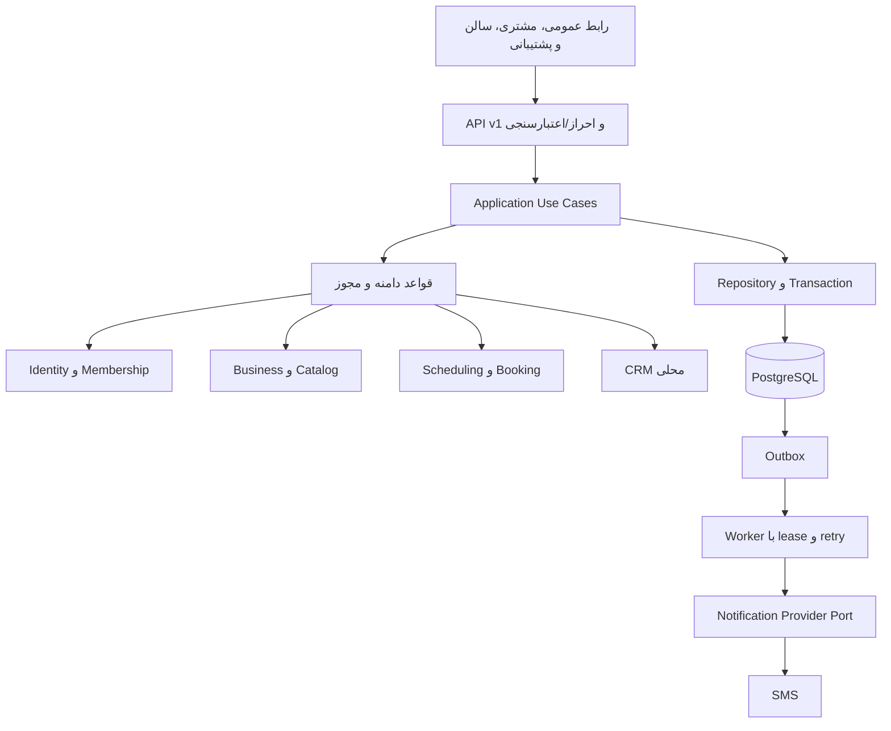
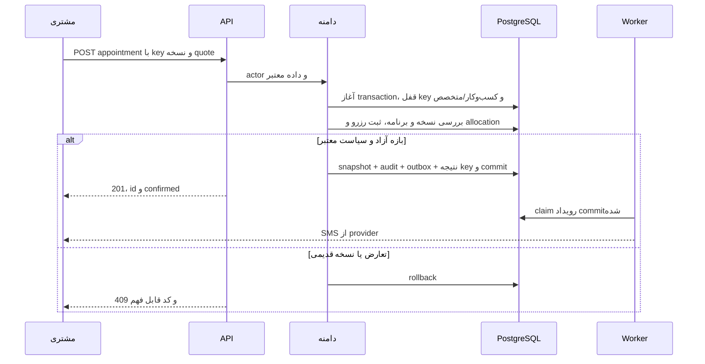

# نمای معماری و وضعیت اجرا
بک‌اند NestJS در `backend/` و فرانت Next.js/React در `frontend/` اجرا شده‌اند؛ سازمان‌دهی ماژولار طبق ADR-002 و ابزار پایه طبق ADR-003 مرجع جاری‌اند. پایه PostgreSQL/Drizzle اسپرینت ۲ و هویت ایمیل/رمز اسپرینت ۳ با دیتابیس واقعی آزموده شدند. [ADR-004](adr/ADR-004-database-foundation.md)، [ADR-005](adr/ADR-005-frontend-backend-layout.md) و [گزارش اسپرینت ۳](../planning/sprints/sprint-03-report.md) انتخاب و نتیجه را ثبت می‌کنند. کشف سالن فعلاً داده نمایشی دارد. نمودارها و مسیر رزرو پایین، معماری هدف قابلیت‌های آینده‌اند؛ Catalog، Booking، Membership، Outbox، worker و SMS هنوز اجرا نشده‌اند. worker در صورت نیاز فرایند جدا با همان کد/مدل و انتشار هماهنگ است؛ microservice مستقل نیست.

منطق slot و transition در کد دامنه مستقل از React/route باشد. use-caseهای create/reschedule/cancel مسئول transaction، مجوز و idempotency‌اند. repository tenant را اجباری دریافت می‌کند؛ رابط عمومی projection محدود دارد. ماژول‌ها داده هم را مستقیم mutate نمی‌کنند. در بک‌اند P0 دیتابیس مشترک و deploy واحد است؛ فرانت می‌تواند جدا مستقر شود. در Nest، Controller مسئول HTTP، Application Service مسئول اجرای کار، قواعد دامنه مسئول قوانین و Repository مسئول دسترسی داده است. لایه و interface فقط برای مسئولیت یا مرز واقعی ایجاد شوند؛ هر endpoint ساده نیازمند چندین abstraction نیست.

## مسیر درخواست رزرو

API و DB درون یک درخواست اثر قطعی ایجاد می‌کنند؛ پیامک async است. caching فقط خواندن عمومی/availability با TTL کوتاه پیشنهادی ۱۵ ثانیه؛ create همواره از DB زنده بررسی می‌کند. Redis برای P0 لازم نیست؛ صف outbox و شمارنده‌های امنیتی با PostgreSQL قابل شروع‌اند و زیر بار باید ارزیابی شوند.

Upload از مسیر محدود با MIME/اندازه/پردازش دوباره تصویر و حذف EXIF؛ object key غیرقابل حدس، دسترسی public فقط تصویر تأییدشده محیط/لوگو. محتوای خصوصی پشت کنترل مجوز است. معماری تصویر نباید به سرویس مسدودشونده خارجی وابسته شود.

نسخه‌ها در ADR بعد از انتخاب ثبت و pin شوند؛ این سند ادعای سازگاری نسخه بررسی‌نشده ندارد. Supabase/Vercel پیش‌فرض الزامی نیستند؛ قابلیت دسترسی، شرایط خدمات برای ایران، هزینه و بازیابی باید ارزیابی شوند.

## قرارداد کد
[ADR-002](adr/ADR-002-code-organization.md)،[ساختار](codebase-structure.md) و [استاندارد بک‌اند](../engineering/backend-standards.md) مسئولیت و جهت import را تعریف می‌کنند. این سند مرجع نمای کلان است و جزئیات پوشه‌ها در آن تکرار نمی‌شود.
