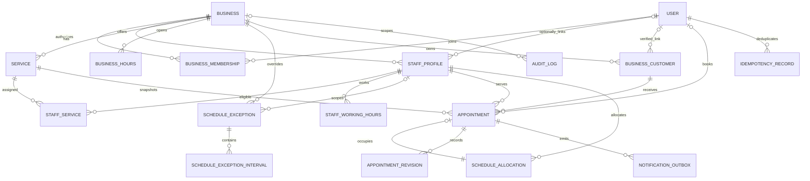

# مدل داده پیشنهادی
PostgreSQL، طرح اولیه غیرقابل اجرا. migration یا پایگاه داده ساخته نشده است. PKها UUID؛ زمان رویداد timestamptz، روز برنامه date و ساعت برنامه time در timezone کسب‌وکار است. همه FKها پیش‌فرض RESTRICT؛ حذف آبشاری تاریخچه رزرو ممنوع. NN=غیرnullable، ?=nullable. فیلدهای created_at/updated_at در رکوردهای mutable پیش‌فرض NN هستند.

| جدول | ستون‌های کلیدی/لازم | nullable و integrity/شاخص |
|---|---|---|
| User | id PK، phone_e164 NN unique، display_name NN، state NN | phone برای حساب فعال لازم؛ هنگام ناشناس‌سازی از جدول هویت جدا/توکن‌سازی شود؛ MFA credential رمزگذاری‌شده در لایه auth جدا |
| Business | id PK، name، category، city، district، public_address، public_phone، timezone، state، booking_policy/version NN | cover_key?، description?؛ timezone=Asia/Tehran در P0؛ index(state,city,district,category)، normalized_name برای جست‌وجو؛ یک محل، بدون مختصات الزامی |
| BusinessMembership | id PK، business_id FK، user_id FK، role، active NN | unique(business_id,user_id)؛ index(user_id,active)؛ آخرین مالک در transaction و قفل Business حفظ شود |
| StaffProfile | id PK، business_id FK، display_name، active NN | user_id?؛ FK(business_id,user_id)→Membership(business_id,user_id)، unique فعال(user_id) WHERE user_id IS NOT NULL؛ unique(business_id,id) |
| Service | id PK، business_id FK، name، price_irr bigint، duration_minutes، buffer_before/after، version، active NN | price≥0 و سقف مصوب، duration>0، بافر≥0؛ unique(business_id,id)؛ قیمت ورودی تومان مضرب ۱۰ ریال باشد؛ index(business_id,active) |
| StaffService | business_id، staff_id، service_id NN | PK(staff_id,service_id)؛ هر دو FK ترکیبی به همان business؛ صلاحیت active هنگام ثبت دوباره بررسی شود |
| BusinessHours | id PK، business_id FK، weekday، start_local، end_local NN | weekday در ۰..۶ با قرارداد شنبه=۰؛ start<end؛ عدم overlap بازه‌های روز برای همان سالن |
| StaffWorkingHours | id PK، business_id، staff_id، weekday، start_local، end_local NN | FK ترکیبی؛ همان قیود بازه؛ index(business_id,staff_id,weekday) |
| ScheduleException | id PK، business_id، local_date، closed NN | staff_id?؛ null یعنی کل سالن؛ یک override هر scope/date؛ indexهای unique مجزا برای staff null/non-null؛ closed=true بدون interval |
| ScheduleExceptionInterval | id PK، business_id، exception_id FK، start_local،end_local NN | child interval برای ساعات جایگزین؛ FK ترکیبی همان tenant، start<end و بدون overlap برای هر exception؛ فقط برای closed=false |
| BusinessCustomer | id PK، business_id، local_name NN | phone_e164?، linked_user_id?، identity_verified_at?، private_note?؛ phone غیرunique چون شماره خانوادگی/بازیافتی؛ اتصال User فقط با اثبات مالکیت و بررسی claim؛ unique(business_id,id)، index(business_id,phone_e164) |
| Appointment | id PK، business_id، staff_id، service_id، business_customer_id، starts_at، ends_at، status، source، version، snapshot_* NN | booking_user_id?، cancelled_actor?، cancel_reason?؛ تمام FKهای tenant ترکیبی؛ ends>starts؛ unique(business_id,id)؛ index(business_id,staff_id,starts_at)، index(booking_user_id,starts_at)؛ actor ایجاد NN |
| ScheduleAllocation | id PK، business_id، staff_id، kind، occupied_range NN | appointment_id?، block_reason?، released_at?؛ appointment⇔appointment_id لازم و block⇔null؛ FKهای ترکیبی؛ فقط یک allocation هر appointment؛ range نیمه‌باز غیرخالی با کران محدود |
| AppointmentRevision | id PK، business_id، appointment_id، version، actor_id، action، occurred_at NN | قبل/بعد زمان/وضعیت/متخصص و دلیل حداقلی؛ unique(appointment_id,version)؛ append-only؛ FK ترکیبی |
| IdempotencyRecord | actor_id، operation، key، request_hash، state، created_at NN | PK(actor_id,operation,key)؛ resource_id?، response_cache?، cache_expires_at?؛ committed state فقط همراه اثر؛ fingerprint تا عمر داده منبع |
| NotificationOutbox | id PK، business_id، appointment_id، appointment_version، event_type، channel، due_at، state، attempts NN | recipient_ref?، provider_ref?، next_attempt_at?، last_error_code?؛ unique logical_key روی رزرو/version/event/channel؛ index(state,due_at)؛ worker lease/claim |
| AuditLog | id PK، actor_type، actor_ref، business_id?، action، target_ref، occurred_at NN | reason?، request_id?، metadata پالایش‌شده؛ append-only، کنترل دسترسی؛ شماره/OTP/متن CRM ثبت نشود |

Appointment snapshot_*: نام خدمت، قیمت IRR، currency=IRR، مدت، بافرها، نسخه خدمت، متن/نسخه سیاست لغو، cancel_deadline_at و timezone ثبت. اصول قیمت/تاریخچه در domain-model مرجعند. برای AppointmentRevision جزئیات مالی جدید از client پذیرفته نشود.

OTPChallenge و Session و MFA recovery در schema ماژول identity با شناسه کاربر و سیاست retention امنیت نگهداری می‌شوند؛ انتخاب کتابخانه auth بعد از ADR انجام می‌شود. مسئولیت آن‌ها: challenge hash/expiry/attempts و نشست قابل revoke؛ استفاده از auth به معنی حذف نیاز به authorization دامنه نیست. هیچ Password سفارشی لازم نیست.

## قیود تعیین‌کننده
پیشنهاد PostgreSQL: extension استاندارد btree_gist در محیط منتخب باید پیش از تصویب زیرساخت آزمایش شود. روی **همان جدول ScheduleAllocation** قید EXCLUDE USING gist (business_id WITH =, staff_id WITH =, occupied_range WITH &&) WHERE (released_at IS NULL) برقرار شود. این شبه‌طرح است؛ DDL اجرایی در این مرحله نداریم. اگر extension فراهم نباشد، پیش از توسعه راهکار معادل با قفل و transaction اثبات و ADR اصلاح شود.

قید overlap دو جدول مستقل Appointment و BlockedTime کافی نیست؛ به همین دلیل دفتر اشغال یکی است. FK تضمین می‌کند allocation متعلق به متخصص و رزرو همان tenant باشد. یک deferred consistency trigger یا معادل enforceشده در DB باید هنگام commit تطابق محدوده allocation با زمان+بافر Appointment، وجود دقیقاً یک allocation برای confirmed/completed/no_show و release برای cancelled را بررسی کند؛ یکتایی و FK به‌تنهایی این تطابق را تضمین نمی‌کنند. تمام نویسندگان فقط از سرویس دامنه می‌نویسند؛ حساب DB برنامه اجازه دورزدن کنترل‌ها/حذف history نداشته باشد.

برای اعضا/خدمات/متخصصان archive یا active=false به‌جای حذف است. retention و حذف حساب نباید زنجیره FK را بشکند؛ نام snapshot و مشتری محلی نیز داده شخصی‌اند و باید در فرآیند ناشناس‌سازی بررسی شوند. soft delete سراسری بدون هدف نداریم. راهبرد isolation در security-and-privacy مرجع است.

## ERD — MVP

Business و Staff در همه جداول فرزند با کلید ترکیبی کنترل شوند؛ نمودار برای خوانایی تمام ستون‌های FK را تکرار نمی‌کند. Allocation نوع block بدون Appointment است؛ هر Appointment دقیقاً یک allocation تاریخی دارد که در لغو released می‌شود.

## توسعه‌های آینده و شرط ورود
- BusinessLocation و تخصیص کارکنان به چند محل: فقط پس از نیاز چندشعبه؛ قید overlap جهانی متخصص باید بازطراحی شود.
- AppointmentSegment/Resource/ResourceAllocation: فقط در صورت تأیید خدمات چندمرحله‌ای یا دستگاه/اتاق مشترک؛ ممکن است به MVP منتقل شود و فعلاً «حل‌شده» نیست.
- Payment/Refund/PaymentAttempt: پس از تعیین بیعانه و قرارداد درگاه ایرانی؛ دفتر مالی، idempotency و verify سمت سرور لازم می‌شود.
- Review با unique(appointment_id)، moderation و گزارش: P1. Loyalty/Inventory/Payroll: P2، بدون جدول رزرو شده از امروز.
