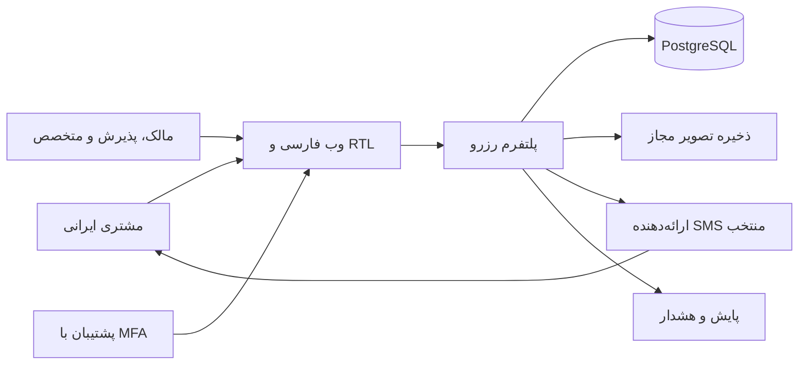

# زمینه سامانه
وضعیت: معماری پیشنهادی برای کشف، بدون پیاده‌سازی. actorهای اصلی در ایران‌اند؛ دسترسی سرویس خارجی از ایران باید اندازه‌گیری شود.

مرز اعتماد: مرورگر نامطمئن است؛ auth/authorization و قیمت نهایی سمت سرور. DB و worker در شبکه خصوصی، provider پیامک بیرون از transaction، ذخیره تصویر با سیاست عمومی/خصوصی مجزا. مراقب عمومی‌شدن فایل private در URL باشیم.

پرداخت، نقشه، geocoding، ایمیل و push در P0 پیش‌شرط جریان نیستند. رزرو پیام‌رسان یا تلفنی فقط وقتی عضو سالن آن را دستی ثبت کند وارد تقویم می‌شود؛ یکپارچگی خودکار با شبکه اجتماعی ادعا نمی‌شود. SMS برای OTP ورودی و اعلان استفاده می‌شود؛ قطع آن به ورود جدید آسیب می‌زند و باید جداگانه پایش شود.
